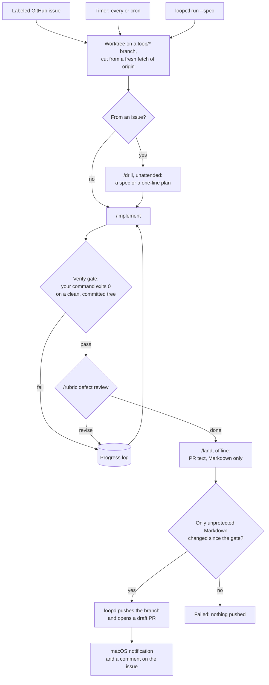
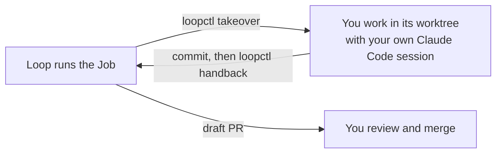

# loopgate

loopgate runs Claude Code on your work while you are away, gates the result on your own verify command, and stops at a draft pull request. **It never merges, never force-pushes, and never pushes to your default branch. Every change waits for a human to review the draft PR.**

It is the outer loop around a Claude Code harness you already have: your `CLAUDE.md`, skills and hooks run every stage. loopgate decides when a job starts, gives each job its own git worktree, gates each implement run, retries within bounds, and ships the draft PR. It runs locally on macOS.

## How a job runs



Any stage can stop the Job as **Blocked** with one question: it reports a decision only you can make, or it changed a protected path. A Job from an issue then posts the question on the issue. When `max_iterations` implement runs or the `timeout` are used up, the Job ends **exhausted**, with no PR.

You and the loop can trade a Job at any point:



Pass or fail comes only from your verify command's exit code, never from the model's claim. Each stage is a fresh `claude -p` session; what earlier implement runs learned reaches the next one through a progress log.

## Requirements

- macOS, Go 1.26.5 or newer, git.
- [Claude Code](https://claude.com/claude-code), logged in. Jobs use your login and count against your usage.
- [GitHub CLI](https://cli.github.com), logged in: `gh auth login`, then `gh auth setup-git`. loopgate stores no tokens.
- The stage skills `drill`, `implement`, `rubric`, `land` and `tldr` in your user-level Claude Code setup. loopgate calls them by name and does not ship them. They come from [pwguler/skills](https://github.com/pwguler/skills): `npx skills add pwguler/skills`, then choose Claude Code. [Skills](#skills) lists what each stage needs from them.

## Install

```sh
go install github.com/yeremi777/loopgate/cmd/...@latest
loopctl install-service
launchctl bootstrap gui/$(id -u) ~/Library/LaunchAgents/loopgate.loopd.plist
```

From a clone, run the same steps from its root, and link the Claude Code skill:

```sh
go install ./cmd/...
loopctl install-service
launchctl bootstrap gui/$(id -u) ~/Library/LaunchAgents/loopgate.loopd.plist
ln -s "$PWD/skills/loopgate" ~/.claude/skills/loopgate
```

`install-service` writes a launchd agent that starts `loopd` at login with your current `PATH`, and restarts it after a crash. Its log is `~/.loopd/loopd.log`. After `PATH` changes, run it again, then `launchctl bootout gui/$(id -u)/loopgate.loopd` and bootstrap again. To remove it: bootout, then delete the plist.

`loopd` only runs while your Mac is awake. A timer fire missed during sleep runs once on wake; further missed fires are dropped.

## Loops

A loop is one YAML file. `loopctl add <file>` validates it and copies it to `~/.loopd/loops/`.

```yaml
name: fix-issues                     # lowercase letters, digits, dashes
checkout: ~/code/app                 # your own clone; job worktrees come from it
trigger:
  github: { repo: owner/app, label: agent, every: 10m }
verify: go test ./... && golangci-lint run
bounds: { max_iterations: 5, timeout: 30m }
protected: [.golangci.yml]           # added to .github/**, .claude/**, **/CLAUDE.md, **/AGENTS.md
tests: ["**/*_test.go"]              # changed or deleted tests are listed in the PR
network: [proxy.golang.org, sum.golang.org]
```

A timer loop replaces `github` with `timer: { every: 6h }` or `timer: { cron: "0 9 * * 1-5" }`, and adds exactly one of `task: <one-line plan>` or `spec: docs/specs/<slug>.md`. See [`examples/`](examples).

| Field | Meaning |
|---|---|
| `verify` | Shell command run in the worktree. Exit 0 is the only pass. |
| `bounds` | Required. `max_iterations` counts implement runs; `timeout` covers the whole job. |
| `protected` | A change to a matching path blocks the job for you to decide. |
| `network` | Domains the sandboxed stages may reach, such as package registries. GitHub domains are refused. The verify command gets no network. |

## Use

| You want | Run |
|---|---|
| Hand a settled spec to a loop | `loopctl run <loop> --spec docs/specs/<slug>.md`, from the checkout's root |
| Build issues while you are away | Label them with the loop's label. Each issue runs once. |
| Run an issue again | `loopctl requeue <loop> <issue>` |
| See a job | `loopctl logs <job>`: state, branch, PR, cost, progress |
| Take a job back | `loopctl takeover <job>`, then work in the worktree it prints |
| Give it back | Commit, then `loopctl handback <job>` |
| End the running job | `loopctl stop <loop>` (the loop keeps its trigger) |
| Silence a loop's trigger | `loopctl pause <loop>`, later `loopctl resume <loop>` |

One job runs at a time. A job ends `done` with a draft PR, `blocked` with a question, `exhausted` when its bounds run out, `failed`, or `manual` after a takeover. A job from an issue answers on the issue: the PR link, or the blocking question with the `needs-drill` label.

The draft PR opens with loopgate's report: the commit that passed the gate and the review, the changed tests, the cost, drill's plan, and the final implement run's summary, which lists its Flags: choices the Job made on its own, for you to accept or reject.

### From a Claude Code session

The repo ships a skill that drives `loopctl` for you. Install it once from a clone:

```sh
git clone https://github.com/yeremi777/loopgate ~/code/loopgate
ln -s ~/code/loopgate/skills/loopgate ~/.claude/skills/loopgate
```

Then say "hand docs/specs/x.md to the loop", "loop status", or "take over job 3".

## Skills

Each stage is a fresh `claude -p` session that loads your user-level settings and skills, never the worktree's own `.claude` settings and never an MCP server. It returns `done`, `blocked` with one question, or `revise`.

| Stage | Invocation | Must leave behind |
|---|---|---|
| drill (issues) | `/drill` with the issue fenced as data | a committed `docs/specs/issue-<n>.md`, or a one-sentence plan as its summary |
| implement | `/implement <spec path or plan>` | every change committed; a summary listing each Flag |
| rubric | `/rubric defect pass, steps 1 to 3 only, on the diff … against commit <base>` | no edits; `revise` with the act-on findings, or `done` |
| land | `/land PR`, or `/land PR, keep spec <path>` when the work is a spec | Markdown-only commits; the PR title, a blank line and the body as its summary |

Summaries follow your `tldr` skill.

## Safety

- No stage can reach GitHub. Stages run in Claude Code's sandbox with no unsandboxed escape, network limited to the loop's `network` list, no MCP servers, and deny rules on commands that start with `gh`, `git push` or `git merge`. `loopd` alone pushes, without force, and only opens draft PRs.
- The verify command runs code the model wrote, so it runs under macOS Seatbelt: no network but localhost, no keychain and no SSH agent (so no GitHub credentials), and writes only to the worktree, `~/.loopd/cache` and `TMPDIR`. The verify command cannot write the worktree's `.git` pointer either. Go modules come from the stages' downloads first, then from your own module cache.
- Stages and the verify command cannot read `~/.ssh`, `~/.aws`, `~/.config/gh`, `~/.gnupg`, `~/.netrc`, `~/.npmrc`, `~/.docker`, `~/.kube` or `~/Library/Keychains`. Stages cannot write the repository's git config, hooks or the worktree's `.git` pointer, and `loopd` runs its own git with hooks and fsmonitor off.
- After every stage, a change to a protected path, committed or not, ignored files included, blocks the job before the next stage starts.
- `land` may change unprotected Markdown only. Any change after the gate to a file that is not Markdown (a rename counts as removing one path and adding another), or a rewrite of the gated commit, fails the job before anything is pushed.
- Issue text reaches the model as fenced, untrusted data. It cannot change the verify command, bounds, protected paths, or stages.
- Stages get an allowlisted environment; your other variables stay in `loopd`. Every stage and verify run is its own process group, which is killed on timeout, stop, or takeover.
- A label starts an issue job. Adding a label takes triage access, but an issue template can add a label for anyone who opens an issue: do not give a loop a label that a template adds.

## Acknowledgements

- The stage skills that every Job runs, `drill`, `implement`, `rubric`, `land` and `tldr`, are [pwguler/skills](https://github.com/pwguler/skills) (MIT). loopgate is the outer loop around them; it runs them unattended and adds its own gates.
- Ideas, not code, came from [pwguler/pi-loop](https://github.com/pwguler/pi-loop) (interval and cron scheduling, a single-owner lock, skip-if-busy fires, hard bounds) and [taufik-hdyt25/AIAgent](https://github.com/taufik-hdyt25/AIAgent) (headless `claude`, a branch per task, process-group kill, environment sanitizing, issue to draft PR).

## License

[MIT](LICENSE)
