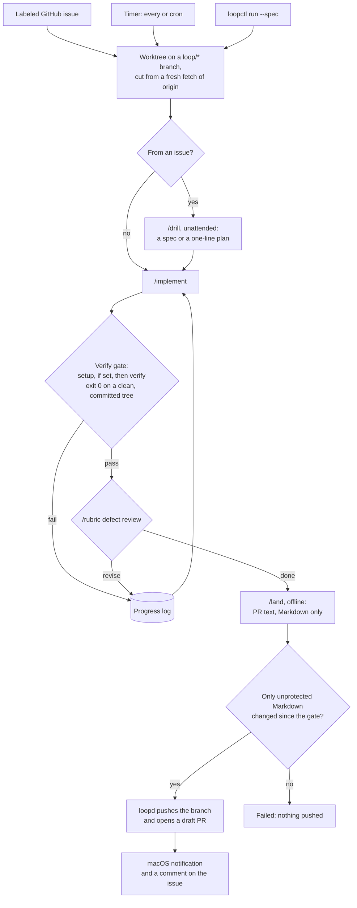
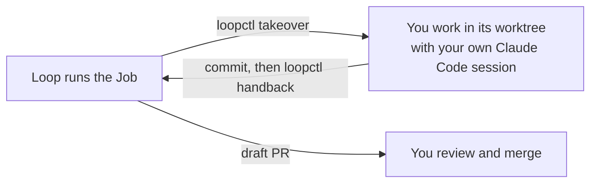

# loopgate

loopgate runs Claude Code on your work while you are away, gates the result on your own verify command, and stops at a draft pull request. **It never merges, never force-pushes, and never pushes to your default branch. Every change waits for a human to review the draft PR.**

It is the outer loop around a Claude Code harness you already have: your `CLAUDE.md`, skills and hooks run every stage. loopgate decides when a job starts, gives each job its own git worktree, gates each implement run, retries within bounds, and ships the draft PR. It runs locally on macOS.

To install or upgrade, go to [Install](#install).

## When to use it

| Hand it to the loop | Stay in your own Claude Code session |
|---|---|
| The work is settled: a spec you drilled, or a small issue with one clear reading | The design is still open, and you want to drill, prototype or decide as you go |
| You are away from your desk, or busy with other work | You want to watch each step and steer it |
| A recurring chore on a schedule, such as dependency bumps | The change needs secrets, accounts, production systems or a data migration; loopgate blocks those anyway |
| A verify command can prove the result | Only a person can judge the result, such as how a UI feels |

You can switch at any time: take a running job back into your session, and hand it back when you are done.

## How a job runs



Any stage can stop the Job as **Blocked** with one question: it reports a decision only you can make, or it changed a protected path. A verify gate that leaves a protected path changed blocks the Job the same way. A Job from an issue then posts the question on the issue. When `max_iterations` implement runs or the `timeout` are used up, the Job ends **exhausted**, with no PR.

You and the loop can trade a Job at any point:



Pass or fail comes only from the exit codes of your setup and verify commands on a clean, committed tree that setup leaves unchanged, never from the model's claim. Each stage is a fresh `claude -p` session; what earlier implement runs learned reaches the next one through a progress log.

## Install

**1. Prerequisites**, once:

- macOS, git, and Go 1.26.5 or newer.
- [Claude Code](https://claude.com/claude-code), logged in. Jobs use your login and count against your usage.
- [GitHub CLI](https://cli.github.com), logged in. loopgate stores no tokens.
  ```sh
  brew install gh
  gh auth login
  gh auth setup-git
  ```
- The stage skills from [pwguler/skills](https://github.com/pwguler/skills). Install them globally for Claude Code before loopgate. Every job calls `drill`, `implement`, `rubric`, `land` and `tldr` by name.
  ```sh
  npx skills add pwguler/skills -g -a claude-code
  ```

**2. loopgate:**

```sh
go install github.com/yeremi777/loopgate/cmd/...@latest
loopctl install
```

From a clone, run `go install ./cmd/...` and `loopctl install` from its root instead.

`loopctl install` starts `loopd` now and at every login with launchd, restarts it after a crash, and adds the loopgate skill to `~/.claude/skills/loopgate`. It first checks for the stage skills in `~/.claude/skills`: a job whose skill is missing runs anyway, without the skill and without an error, so install names the missing ones and stops. It prints where it found `claude`, `gh`, `git`, `node` and `go`, then waits until `loopd` answers; when `loopd` cannot start, as when `gh` is not logged in, install fails with the error `loopd` logged. Fix the cause and run it again. Run it again after an upgrade; it replaces the loaded copy. `loopctl uninstall` stops `loopd` and removes the agent and the skill; your loops and jobs in `~/.loopd` stay.

**3. Check it:** `loopctl version` prints the installed version, and `loopctl list` prints a table with only its header row. If it later says `loopd not running`, read `~/.loopd/loopd.log`.

To upgrade, run the same `go install …@latest` and `loopctl install` again.

To remove loopgate, run `loopctl uninstall`, then delete the binaries with `rm "$(go env GOPATH)/bin/loopd" "$(go env GOPATH)/bin/loopctl"`. Delete `~/.loopd` too to drop your loops, jobs and caches.

### Configuration

| Variable | Default | Meaning |
|---|---|---|
| `PATH` | your shell's | `loopctl install` hands it to `loopd` with each missing or relative entry dropped, and each link to a link replaced by its target, so fnm's per-shell directory becomes its stable `aliases/default` and follows `fnm default`; run install from a shell where `fnm use` has not switched versions. Homebrew's `opt` links stay as they are and follow upgrades. After you move `claude`, `gh` or `git`, run `loopctl install` again. |
| `LOOPD_HOME` | `~/.loopd` | Where loops, jobs, worktrees, caches and the log live. Set it before `loopctl install`, and in every shell that runs `loopctl`. Keep it short: its socket path must stay under 104 bytes. |

No `.env` file and no token are needed: Claude Code and `gh` keep their own logins in your keychain.

`loopd` only runs while your Mac is awake. A timer fire missed during sleep runs once on wake; further missed fires are dropped.

## Loops

A loop is one YAML file. `loopctl add <file>` validates it, checks the checkout, runs the loop's trial gate, and only then copies it to `~/.loopd/loops/`:

- The `checkout` must be the top level of a clone with `origin/HEAD` set; `git -C <checkout> remote set-head origin --auto` sets it. A GitHub loop's `repo` must be the repo `origin` points at.
- The trial gate runs the loop's `setup` and `verify` commands on a fresh worktree of `origin`'s default branch, sandboxed as in a job and within `bounds.timeout`. When it fails, add prints its output, and adds nothing; when it runs past the timeout, add says so. Both name each host outside `network` that setup tried to reach. Add each such host to `network`, or change `setup` so it does not reach it, and run `loopctl add` again. A loop whose verify command fails on the default branch would fail every job, so fix the branch first.

```yaml
name: fix-issues                     # lowercase letters, digits, dashes
checkout: ~/code/app                 # your own clone; job worktrees come from it
trigger:
  github: { repo: owner/app, label: agent, every: 10m }
verify: go test ./... && golangci-lint run
bounds: { max_iterations: 5, timeout: 30m }
protected: [.golangci.yml]           # added to .github/**, .claude/**, **/CLAUDE.md, **/AGENTS.md
tests: ["**/*_test.go"]              # changed or deleted tests are listed in the PR
network: [proxy.golang.org, sum.golang.org]
```

A loop whose dependencies live in the worktree, such as `node_modules` or `.venv`, installs them with `setup`, because the verify command runs offline:

```yaml
setup: npm ci                        # or pnpm install --frozen-lockfile, uv sync
verify: npm test
network: [registry.npmjs.org]
```

A timer loop replaces `github` with `timer: { every: 6h }` or `timer: { cron: "0 9 * * 1-5" }`, and adds exactly one of `task: <one-line plan>` or `spec: docs/specs/<slug>.md`. See [`examples/`](examples).

| Field | Meaning |
|---|---|
| `verify` | Shell command run in the worktree. Exit 0 is the only pass. |
| `setup` | Optional. Shell command run in the worktree before each verify command, to install what the offline verify command needs. It must exit 0 and change no tracked file, and what it installs must be gitignored. When the gate fails, `loopctl logs <job>` names each host outside `network` that setup tried to reach. The install tool must honor `HTTPS_PROXY`; one that ignores it fails without a named host. With pnpm through corepack, run `pnpm --version` in the checkout first, and again after `packageManager` changes: setup cannot write corepack's own cache. |
| `bounds` | Required. `max_iterations` counts implement runs; `timeout` covers the whole job. |
| `protected` | A change to a matching path blocks the job for you to decide. |
| `network` | Domains the sandboxed stages and the setup command may reach, such as package registries. GitHub domains are refused. The verify command gets no network. |

## Use

| You want | Run |
|---|---|
| Hand a settled spec to a loop | `loopctl run <loop> --spec docs/specs/<slug>.md`, from the checkout's root |
| Build issues while you are away | Label them with the loop's label. Each issue runs once. |
| Run an issue again | `loopctl requeue <loop> <issue>` |
| See a job | `loopctl logs <job>`: state, branch, PR, cost, progress |
| Watch a job live | `loopctl logs -f <job>`: each stage and verify gate as it starts and ends, one line per tool call and Claude message, then the outcome. Ctrl-C leaves the job running. The live lines last only while the job runs. |
| Take a job back | `loopctl takeover <job>`, then work in the worktree it prints |
| Give it back | Commit, then `loopctl handback <job>` |
| End the running job | `loopctl stop <loop>` (the loop keeps its trigger) |
| Silence a loop's trigger | `loopctl pause <loop>`, later `loopctl resume <loop>` |

One job runs at a time. A job ends `done` with a draft PR, `blocked` with a question, `exhausted` when its bounds run out, `failed`, or `manual` after a takeover. A job from an issue answers on the issue: the PR link, or the blocking question with the `needs-drill` label.

The draft PR opens with loopgate's report: the commit that passed the gate and the review, the changed tests, the cost, drill's plan, and the final implement run's summary, which lists its Flags: choices the Job made on its own, for you to accept or reject.

### From a Claude Code session

`loopctl install` adds a loopgate skill that drives `loopctl` for you. In any session, say "hand docs/specs/x.md to the loop", "loop status", or "take over job 3".

## Skills

Each stage is a fresh `claude -p` session that loads your user-level settings and skills, never the worktree's own `.claude` settings and never an MCP server. It returns `done`, `blocked` with one question, or `revise`.

| Stage | Invocation | Must leave behind |
|---|---|---|
| drill (issues) | `/drill` with the issue fenced as data | a committed `docs/specs/issue-<n>.md`, or a one-sentence plan as its summary |
| implement | `/implement <spec path or plan>` | every change committed; a summary listing each Flag |
| rubric | `/rubric defect pass, steps 1 to 3 only, on the diff … against commit <base>` | no edits; `revise` with the act-on findings, or `done` |
| land | `/land PR`, or `/land PR, keep spec <path>` when the work is a spec | Markdown-only commits; the PR title, a blank line and the body as its summary |

Summaries follow your `tldr` skill.

## Safety

- No stage can reach GitHub. Stages run in Claude Code's sandbox with no unsandboxed escape, network limited to the loop's `network` list, no MCP servers, and deny rules on commands that start with `gh`, `git push` or `git merge`. `loopd` alone pushes, without force, and only opens draft PRs.
- The verify command runs code the model wrote, so it runs under macOS Seatbelt: no network but localhost, no keychain and no SSH agent (so no GitHub credentials), and writes only to the worktree, `~/.loopd/cache` and `TMPDIR`. The verify command cannot write the worktree's `.git` pointer either. Go modules come from the stages' downloads first, then from your own module cache.
- The setup command runs code the model can change, such as `postinstall` scripts, so it runs under the same Seatbelt profile as the verify command. Beyond localhost, which any local service listens on, its only way out is a proxy in `loopd` that tunnels to port 443 of the loop's `network` domains; the proxy refuses everything else, ends its tunnels when setup ends, and a failed gate names each host it refused. Setup can still send what it reads to those domains. Stages, setup and verify keep the npm, pnpm, uv and pip caches in `~/.loopd/cache`, which every loop shares.
- Stages, the setup command and the verify command cannot read `~/.ssh`, `~/.aws`, `~/.config/gh`, `~/.gnupg`, `~/.netrc`, `~/.npmrc`, `~/.docker`, `~/.kube` or `~/Library/Keychains`. Stages cannot write the repository's git config, hooks or the worktree's `.git` pointer, and `loopd` runs its own git with hooks and fsmonitor off.
- After every stage, a change to a protected path, committed or not, ignored files included except installed dependencies under `node_modules` and `.venv` outside `.claude/` and `.github/`, blocks the job before the next stage starts. The same check runs after every verify gate.
- `land` may change unprotected Markdown only. Any change after the gate to a file that is not Markdown (a rename counts as removing one path and adding another), or a rewrite of the gated commit, fails the job before anything is pushed.
- Issue text reaches the model as fenced, untrusted data. It cannot change the verify command, bounds, protected paths, or stages.
- Stages get an allowlisted environment; your other variables stay in `loopd`. Every stage, setup and verify run is its own process group, which is killed on timeout, stop, or takeover.
- A label starts an issue job. Adding a label takes triage access, but an issue template can add a label for anyone who opens an issue: do not give a loop a label that a template adds.

## Acknowledgements

The stage skills that every Job runs, `drill`, `implement`, `rubric`, `land` and `tldr`, are [pwguler/skills](https://github.com/pwguler/skills) (MIT). loopgate is the outer loop around them: it runs them unattended and adds its own gates.

## License

[MIT](LICENSE)
